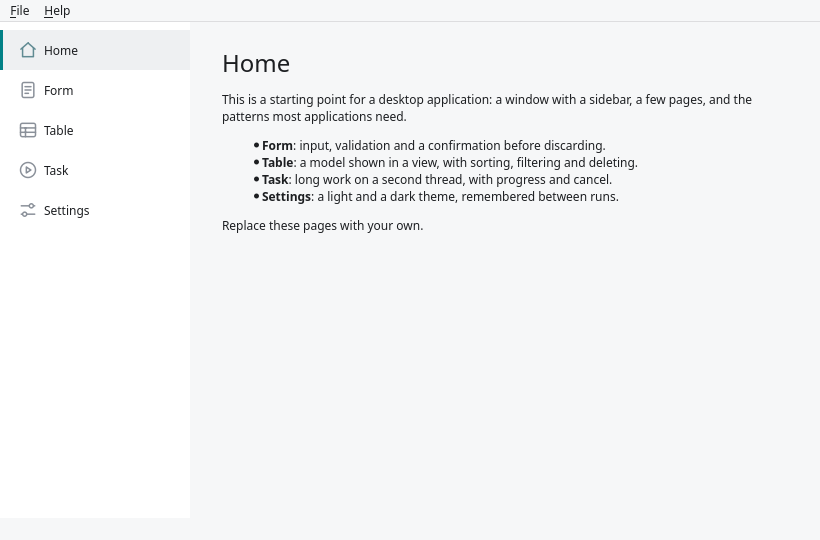
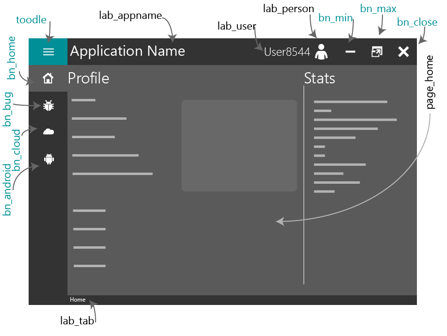

# pyside6-gui-template

A flat, dark desktop GUI to start a Python application from: PySide6
(Qt 6), laid out in Qt Designer, for Windows, Linux and macOS.

<p align="center">
  
</p>

The screenshots are of the original design, which drew its own title bar with
minimise, maximise and close buttons. The template now uses the system's
window frame; the rest is as pictured.

It is a PySide6 port of
[Minimalistic-Flat-Modern-GUI-Template](https://github.com/anjalp/Minimalistic-Flat-Modern-GUI-Template)
by Anjal.P, which targets PySide2. The design, the layouts and the guide the
documentation is converted from are theirs. The port to PySide6, the docs site
and the template tooling are by
[Cameron Brooks](https://github.com/CameronBrooks11).

Documentation: <https://cameronbrooks11.github.io/pyside6-gui-template/>, built
from [`docs/`](docs/index.md).

## What is in it

- An ordinary window with the system's title bar and border, so moving,
  resizing and snapping behave as in any other application, and a header of
  its own inside it for the menu toggle, the application name and the user.
- Side menu with four example pages (Home, Bug, Android, Cloud) on a stacked
  widget, and a toggle that widens the menu and swaps each page for its About
  page.
- Styled widgets: push buttons, progress bar, radio buttons, check boxes, line
  and text edits, sliders, vertical scroll bars, combo box.
- A dialog box and an error box, each called with one function that sets the
  heading, message, icon and button text.

## Quick start

With [uv](https://docs.astral.sh/uv/) and [just](https://just.systems/):

```sh
just setup   # install the app, PySide6 and the dev tools into .venv
just run     # launch the GUI
```

Without just, run `uv sync` and then `uv run python -m app`, or `uv run app`.
Without uv, `pip install -e .` in an environment of your own and run
`python -m app`. The icons are compiled into the package, so it runs from any
directory.

`just check` runs the formatter, the linter and the type checker without
changing anything; `just fmt` applies the formatting. `just test` builds
every window on Qt's offscreen platform and clicks through
the pages, the menu toggle and the example widgets. It
fails on a Python or Qt warning (a deprecated Qt call included), an exception
in a slot, a page that does not switch, an icon path with no file or resource
behind it, and a generated module that is out of date with its `.ui` or `.qrc`
source. It does not show what the GUI looks like.

## Layout

The application is the `app` package in `src/app/`. Rename it to your own.

| File                                             | Purpose                                                            |
| ------------------------------------------------ | ------------------------------------------------------------------ |
| `src/app/__main__.py`                            | Entry point for `python -m app` and the `app` command              |
| `src/app/main_window.py`                         | The main window: header, menu, switching pages                     |
| `src/app/pages.py`                               | What the widgets on the example pages do; replace with your own    |
| `src/app/dialogs.py`                             | The dialog box and the error box                                   |
| `src/app/theme.py`                               | Loading `style.qss`, and the font fallbacks                        |
| `src/app/about.py`                               | Text shown in the About panel of each page                         |
| `src/app/ui/*.ui`                                | Qt Designer sources                                                |
| `src/app/ui/ui_*.py`                             | Generated from the `.ui` files; do not edit by hand                |
| `src/app/resources/style.qss`                    | The one stylesheet: every colour and widget style                   |
| `src/app/resources/`                             | The icons and `resources.qrc`, the Qt resource file that lists them |
| `src/app/ui/resources_rc.py`                     | The resources compiled from `resources.qrc`; do not edit by hand    |
| `docs/`, `mkdocs.yml`                            | The documentation site: layout, widget names, stylesheets          |
| `smoke.py`                                       | The test behind `just test`                                        |

## Making it yours

1. Open a `.ui` file in Qt Designer (`uv run pyside6-designer
   src/app/ui/ui_main.ui`) and change the layout. The forms look plain
   there: the colours come from `style.qss` when the application runs.
2. Change colours and widget styles in `src/app/resources/style.qss`.
3. Run `just uic` to regenerate the `ui_*.py` modules and `resources_rc.py`.
4. Wire the widgets up in `pages.py`. `ExamplePages.__init__` connects the
   widgets of the example pages and is the place to copy from.
5. Set the application name, `APP_NAME`, in `main_window.py`.
6. Set `name`, `description` and `version` in `pyproject.toml`, then run
   `uv lock`: the lock file records the project's name and version, and CI
   installs with `uv sync --locked`, which refuses a lock that is out of date.
7. Rename the `app` package: the `src/app/` directory, the `[project.scripts]`
   line and `module-name` in `pyproject.toml`, the paths in the `run` and
   `uic` recipes of the justfile, and `PACKAGE` at the top of `smoke.py`.
   `just test` fails if the directory and `PACKAGE` disagree; it does not
   read the script line or the justfile, so look those over yourself. The
   docs and a few comments also say `python -m app`.
8. Keep `LICENSE` with its Anjal.P notice, which the MIT terms require of
   copies, and add your own copyright line to it.
9. Replace this README and `docs/` with your own, and set `site_name`,
   `site_description`, `site_url`, `repo_url` and `repo_name` in `mkdocs.yml`.
   If you do not want a docs site, delete `docs/`, `mkdocs.yml` and
   `.github/workflows/docs.yml`, the `docs` and `docs-build` recipes in the
   justfile, the Docs step in `.github/workflows/check.yml` and the `docs`
   group in `pyproject.toml`, then run `uv lock`.
10. `.github/workflows/check.yml` runs `just check`, `just test` and
    `just docs-build` on every pull request into `main`. It and `docs.yml` ask
    for Python 3.10, the oldest version `requires-python` allows: change both
    if you raise that floor.

The documentation covers each of these steps:
[the object name of every widget](docs/layout.md),
[adding a menu button, a page or a widget](docs/customising.md), and
[the calls and stylesheet for each widget type](docs/widgets.md).
`just docs` serves it locally.

<p align="center">
  
</p>

## License

MIT, copyright 2020 Anjal.P. See [LICENSE](LICENSE).

## Credits

- Original design, layouts and guide: [Anjal.P](https://github.com/anjalp).
- PySide6 port, documentation site and template tooling:
  [Cameron Brooks](https://github.com/CameronBrooks11).
