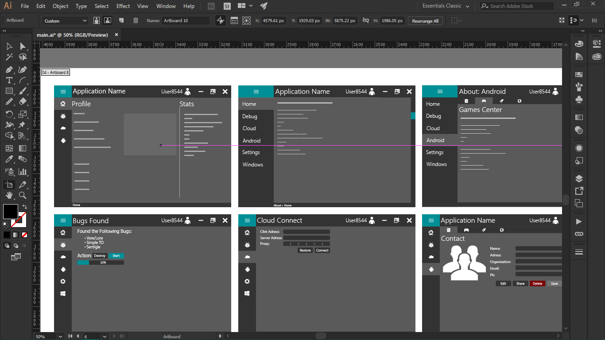
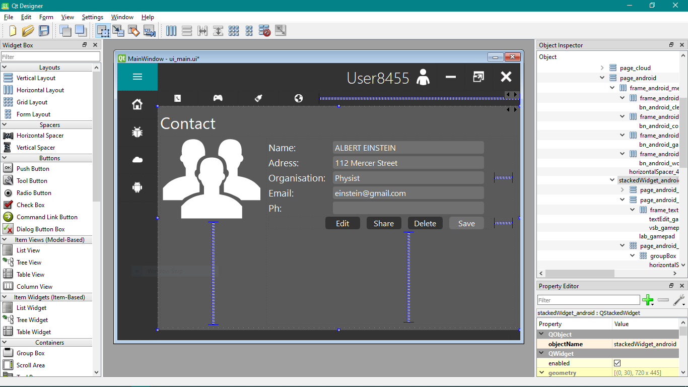
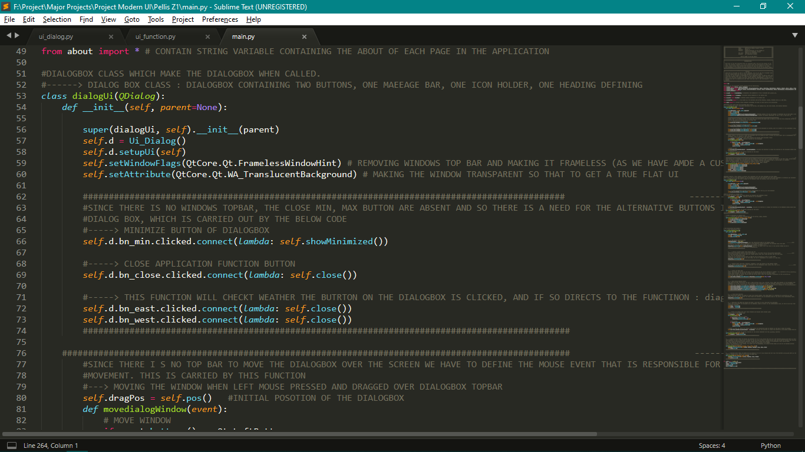

# Design approach

This page is the original author's account of how the template was designed,
lightly edited. "I" here is Anjal.P.

GUI design is a tedious job, especially for desktop software: there are
several operating systems to code for and few tools to get going with. That is
where Qt comes in. It is supported in C++ and Python, runs on Windows, Linux,
macOS and Android, and among the Python GUI toolkits it stands out for its
documentation and the size of its community.

What I like most about Qt is the designer it comes with. It makes laying out a
GUI a drag-and-drop process, which is a big relief when arranging widgets
across a window, and it leaves room to customise the look, build custom
widgets and try new layouts. My routine has three steps:

1. Sketch the overall GUI for the application you want to build.
2. Draw that design in a graphics application. My favourite is Adobe
   Illustrator.
3. Once the design is settled, build it for real in Qt Designer and Python.

Sketching is where you decide what the application needs: how many buttons,
how many windows, which text fields. Drawing it in design software is the long
step. You spend the time on where each button goes, which colour to use where,
and trying different styles for a widget, and you come out of it with a
finished design.

The last step is to implement that design with Qt Designer and Python.
Following a design you have already settled makes the build easy and
satisfying. I mostly sketch with pen and paper. Illustrator is a good way to
draw the design but it is paid; Inkscape is free, one of the best, and
available for Windows and Linux.

## In pictures

Working on the design in Illustrator:

Recreating it in Qt Designer:

Coding the behaviour:

This looks like a long process, but it is the best approach I know for
producing a better design.

In Qt Designer I set everything I can: size, icons, labels, stylesheet,
position and arrangement. That leaves the code free to deal only with what the
widgets do.

## What comes out

- `main.py`
- `ui_function.py`
- `ui_main.py`, generated from `ui_main.ui` with `pyside6-uic`
- `ui_dialog.py`, generated from `ui_dialog.ui`
- `ui_error.py`, generated from `ui_error.ui`

[Getting started](getting-started.md#the-files) says what each one is for.
