# Gallery

The window opens at 800 × 550. The full-screen captures are 1366 × 768.

## Home

A profile panel and a stats panel.

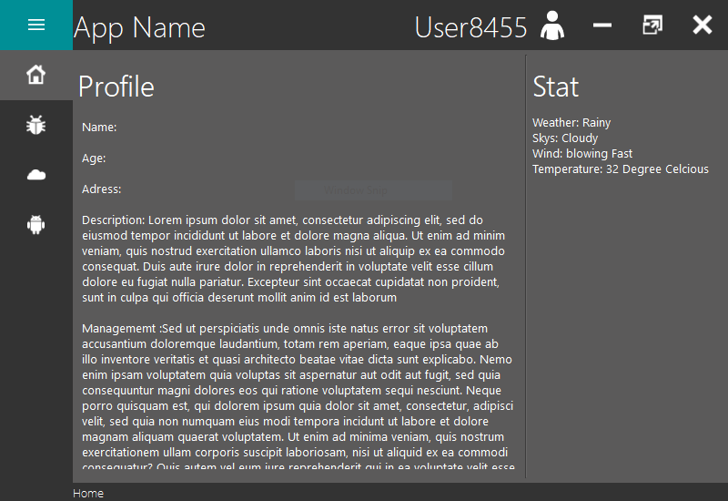

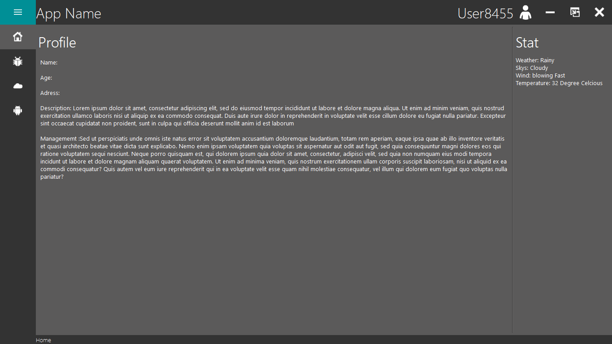

## Bug

A push button, a progress bar and a combo box. Start fills the progress bar
from a timer and the window stays responsive while it runs. The number chosen
in the combo box sets the pace, 1 ms per percent for each million and never
less than 1 ms, so the two smallest numbers both take about a tenth of a
second and the largest about ten seconds.

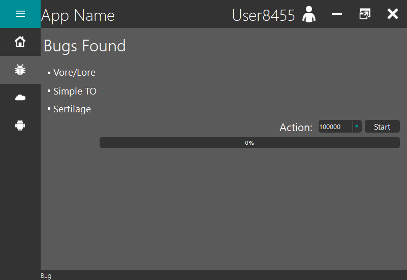

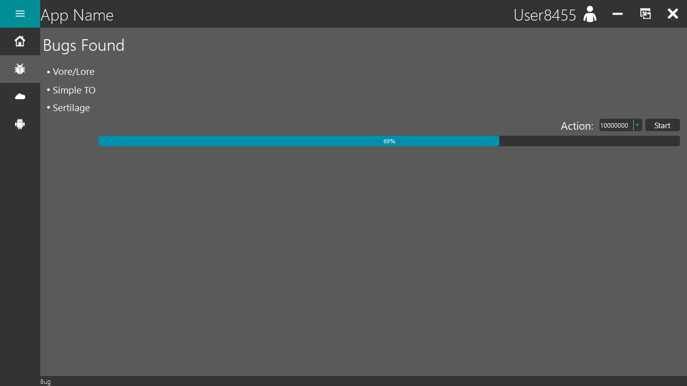

## Cloud

Three line edits and two push buttons. Connect checks the two fields against a
hard-coded pair and raises the error box when they do not match.

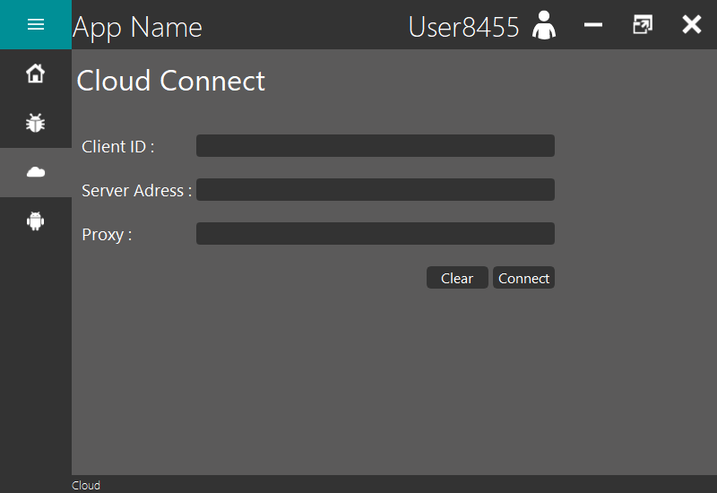

## Android

A stacked widget inside a page, with its own row of buttons: Contact, GamePad,
Clean and World.

### Contact

Line edits that Edit enables and Save disables again. Delete raises the dialog
box and empties the fields if the answer is Yes.

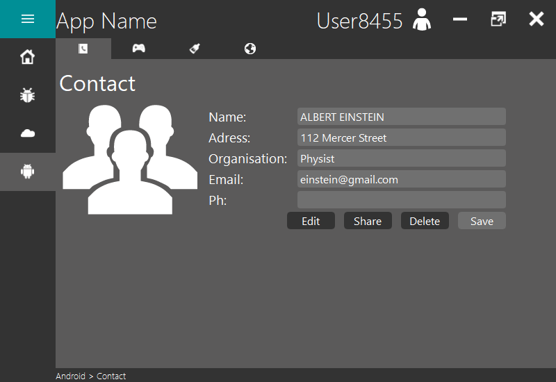

### GamePad

A text edit with a custom vertical scroll bar.

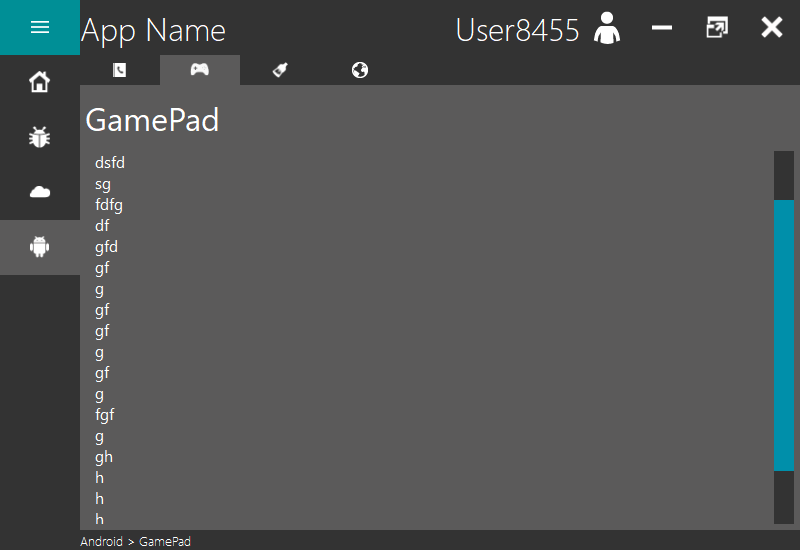

### Clean

Check boxes, radio buttons and sliders.

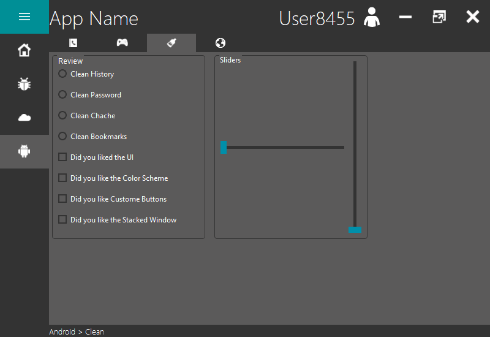

## About

The toggle button widens the menu and shows the About page of Home, whichever
page was showing. With the menu wide, each menu button shows the About page of
its page.

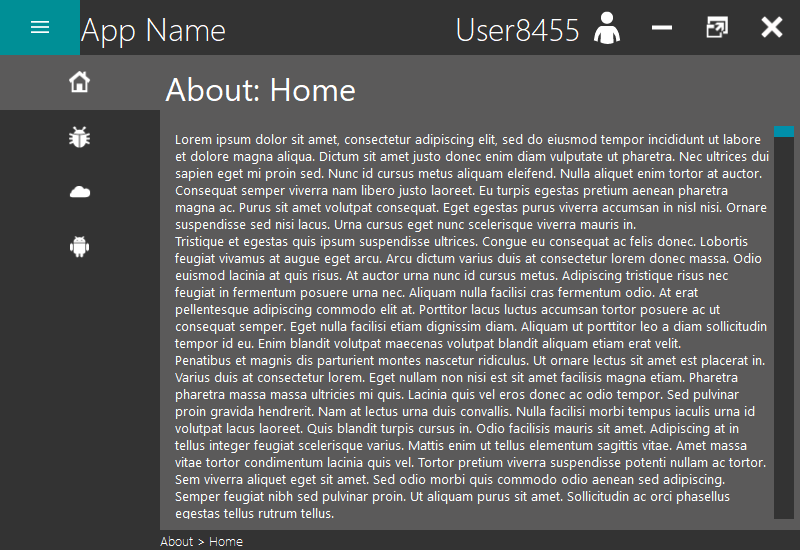

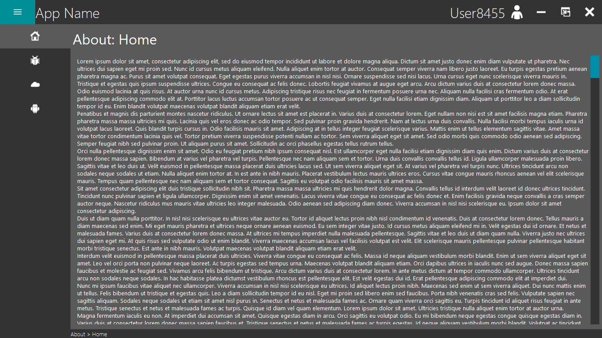

## Dialog box

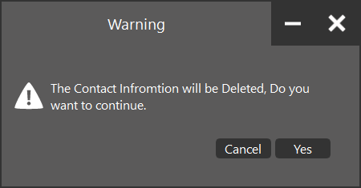

## Error box

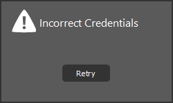
