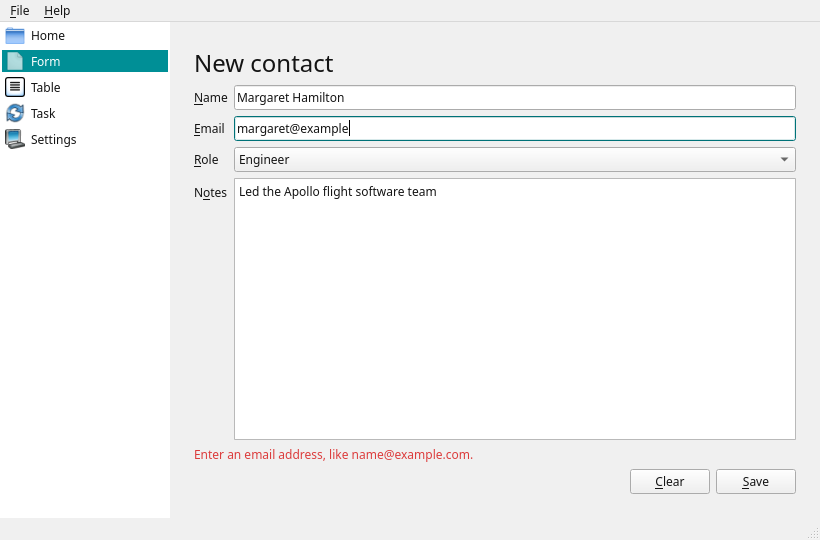
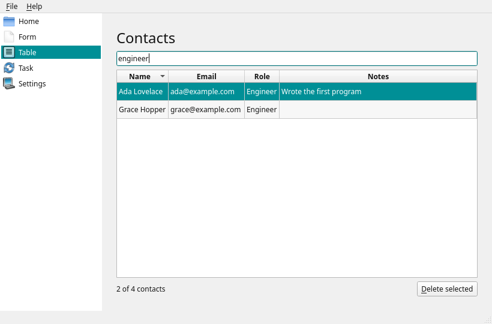
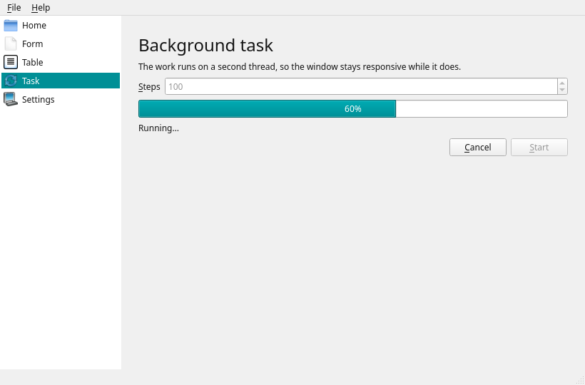
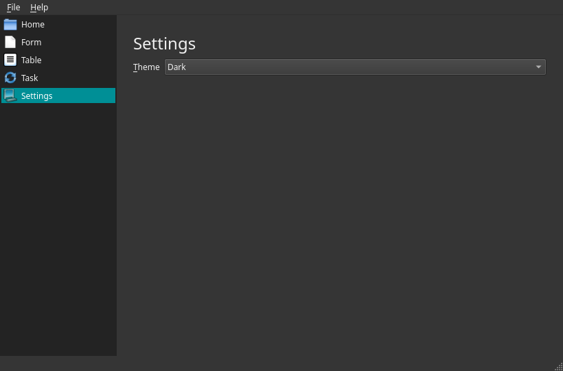
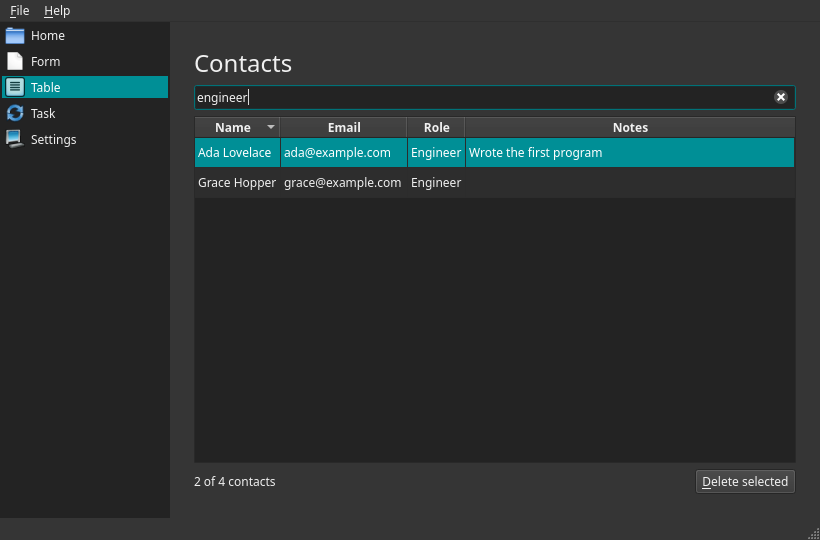

# pyside6-gui-template

A desktop application to start your own from: PySide6 (Qt 6), laid out in
Qt Designer, for Windows, Linux and macOS.

It is an ordinary Qt main window: the system's title bar, a menu bar, a status
bar, a sidebar and a stack of pages. Each example page shows one thing most
applications need, in as little code as does it properly.

[Getting started](getting-started.md) covers installing and running it, and
[Customising](customising.md) covers turning it into your own application.

## Form

Input with validation. Save refuses a missing name or a malformed email and
says why under the fields. Clear asks before discarding what was typed. A
saved contact is added to the table and named in the status bar.

Code: `pages/form.py`, form: `ui/form_page.ui`.

## Table

A `QAbstractTableModel` shown in a `QTableView` through a
`QSortFilterProxyModel`. Click a header to sort, type to filter across every
column, and delete the selected rows after a confirmation.

Code: `pages/table.py` and `contacts.py`, form: `ui/table_page.ui`.

## Task

Long work on a second thread. A worker object is moved to a `QThread` and
reports progress with a signal, so the window stays responsive, and Cancel
stops it at the next step. Closing the window stops a running task first.

Code: `pages/task.py` and `worker.py`, form: `ui/task_page.ui`.

## Settings

A choice of System, Light or Dark, applied at once and remembered between
runs with `QSettings`, as is the size of the window.

Code: `pages/settings.py` and `theme.py`, form: `ui/settings_page.ui`.

!!! note

    The screenshots are generated from the application by `just screenshots`,
    on Qt's offscreen platform, so they show the window's contents without
    the title bar your system draws, and in that platform's font.
