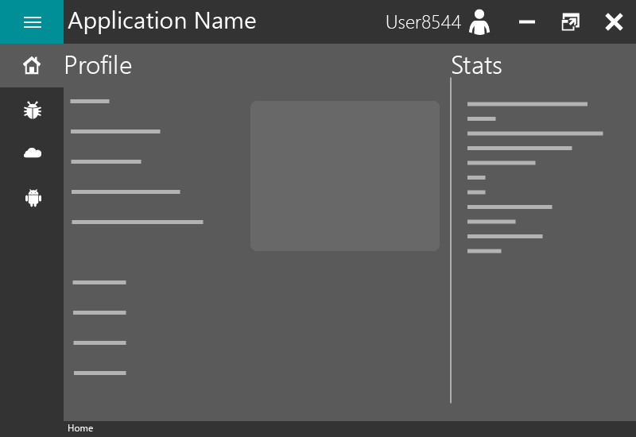
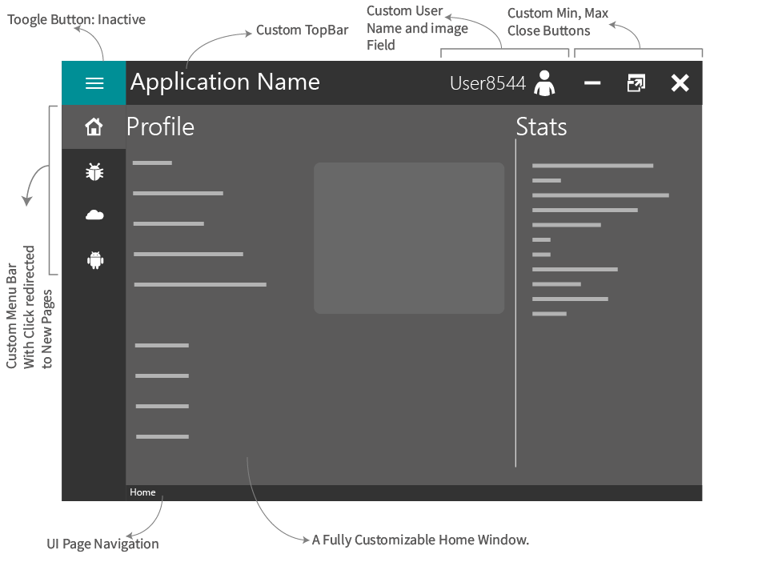
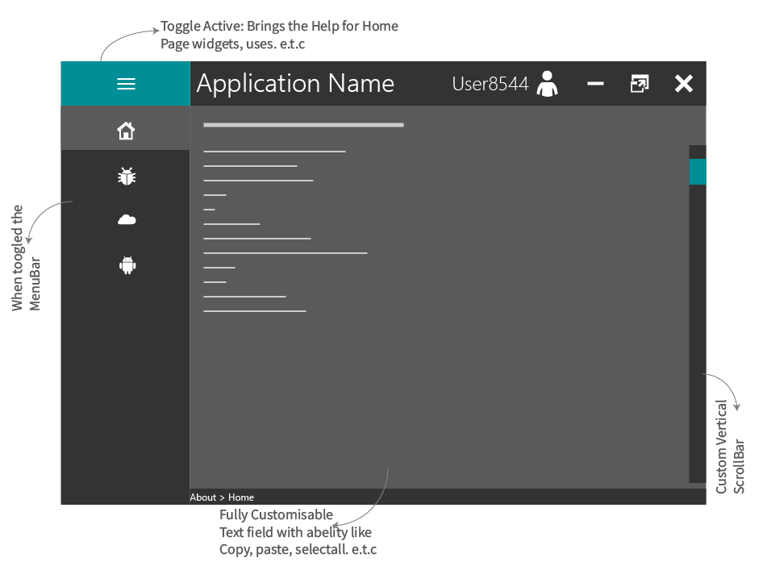
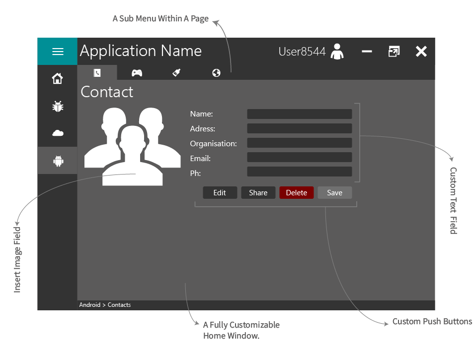
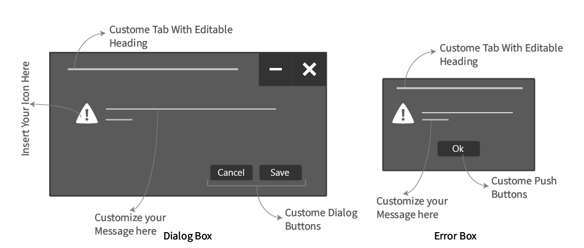
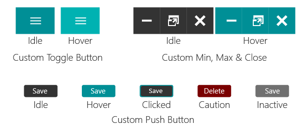
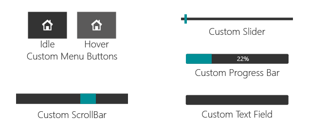
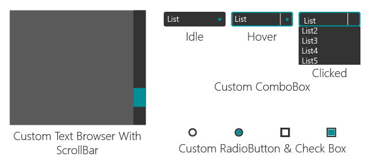

# pyside6-gui-template

A flat, frameless desktop GUI to start a Python application from: PySide6
(Qt 6), laid out in Qt Designer, for Windows, Linux and macOS.

It is a PySide6 port of
[Minimalistic-Flat-Modern-GUI-Template](https://github.com/anjalp/Minimalistic-Flat-Modern-GUI-Template)
by Anjal.P, which targets PySide2. The design, the layouts and the guide these
pages are converted from are theirs; see [Credits](credits.md).

## What is in it

- Flat, two-tone design with one accent colour.
- Frameless window with its own title bar: drag, minimise, maximise, restore
  and close.
- Side menu with four example pages (Home, Bug, Android, Cloud) on a stacked
  widget, and a toggle that widens the menu into an About panel for each page.
- Styled widgets: push buttons, progress bar, radio buttons, check boxes, line
  and text edits, horizontal and vertical sliders and scroll bars, combo box,
  text browser.
- A dialog box with a heading, a message, an icon and two buttons you set per
  call.
- An error box with a heading, an icon and one button you set per call.

## Where to go next

| Page                                  | What it covers                                                  |
| ------------------------------------- | --------------------------------------------------------------- |
| [Getting started](getting-started.md) | Install, run, check, and what each file is for                  |
| [Gallery](gallery.md)                 | Every page, the dialog box and the error box                    |
| [Layout](layout.md)                   | Colours, fonts, and the object name of every frame and widget   |
| [Customising](customising.md)         | Adding a menu button and page, adding widgets, calling the boxes |
| [Widgets and stylesheets](widgets.md) | The calls and the Qt stylesheet for each widget type            |
| [Design approach](design-approach.md) | How the original author went from sketch to Qt Designer         |

## Tour

The home page, with the parts of the window named:

The toggle at the top left widens the menu and switches each page to its About
panel:

A page can hold its own stacked widget. The Android page has four sub-pages
behind a second row of buttons:

The dialog box and the error box:

The styled widgets:

