# Layout

To code against the GUI you need the object name of each frame and widget.
This page gives them as diagrams, next to a screenshot with the same names
pointed at the parts they belong to.

In the tree diagrams each object is a box with its class above it and its
object name inside. Frames have a dotted outline, widgets a blue one, and
everything else a solid one.

## Colours

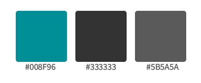

These are the main values `style.qss` uses:

| Colour                  | Hex       | Used for                                                    |
| ----------------------- | --------- | ----------------------------------------------------------- |
| `rgb(51,51,51)`         | `#333333` | Title bar, menu, buttons and input fields at rest           |
| `rgb(91,90,90)`         | `#5B5A5A` | Page background, hovered and selected menu buttons          |
| `rgb(0,143,150)`        | `#008F96` | Accent: toggle button, hovered window and push buttons      |
| `rgb(0,143,170)`        | `#008FAA` | Accent on progress chunks, slider and scroll handles, combo box hover, checked indicators |
| `rgb(0,178,178)`        | `#00B2B2` | Hovered toggle button                                       |
| `rgb(112,112,112)`      | `#707070` | Disabled buttons and fields                                 |
| `rgb(112,0,0)`          | `#700000` | Hovered Delete button                                       |
| `rgb(255,255,255)`      | `#FFFFFF` | Text                                                        |

To recolour the GUI, change these in `src/app/resources/style.qss` and run
`just uic`; see [Change the look](customising.md#change-the-look).

## Fonts

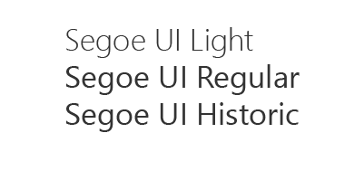

The `.ui` files ask for Segoe UI, Segoe UI Light and Segoe UI Semilight. Segoe
UI ships with Windows. Where it is not installed, `FONT_FALLBACKS` in `main.py`
names the fonts to use instead, in order of preference, with the system's own
font as the last resort, and all three families fall back to the same one. A
name in the list has to be an installed family; a generic name such as
`Sans Serif` is ignored. The light weights are not carried over.

A family set on a widget in the `.ui` file wins over `QApplication.setFont`,
so to change the typeface, change it in Qt Designer.

## Main window

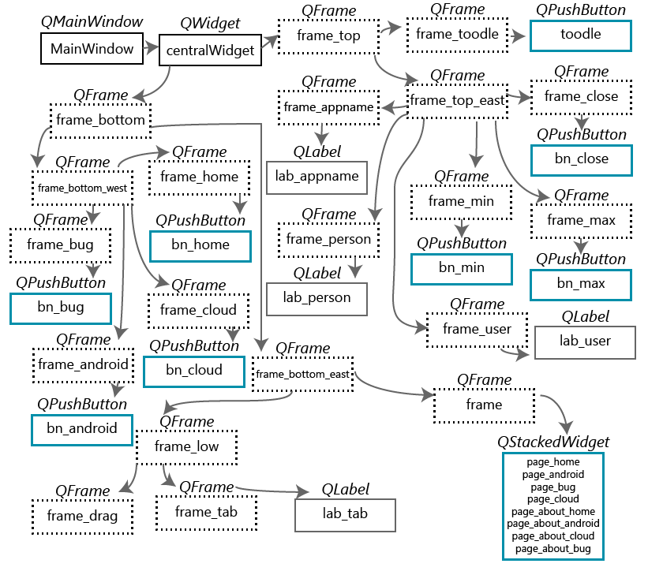

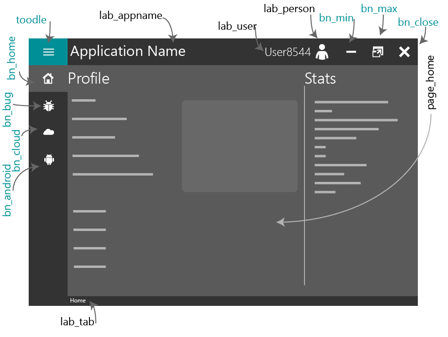

The pages live in `stackedWidget`. Each menu button has a page and an About
page:

| Index | Page                 | Shown by                         |
| ----- | -------------------- | -------------------------------- |
| 0     | `page_home`          | `bn_home`                        |
| 1     | `page_about_home`    | `bn_home` with the menu widened  |
| 2     | `page_about_cloud`   | `bn_cloud` with the menu widened |
| 3     | `page_about_android` | `bn_android` with the menu widened |
| 4     | `page_about_bug`     | `bn_bug` with the menu widened   |
| 5     | `page_bug`           | `bn_bug`                         |
| 6     | `page_cloud`         | `bn_cloud`                       |
| 7     | `page_android`       | `bn_android`                     |

The main window holds too many pages for one diagram, so each page follows
with its own.

## Home page

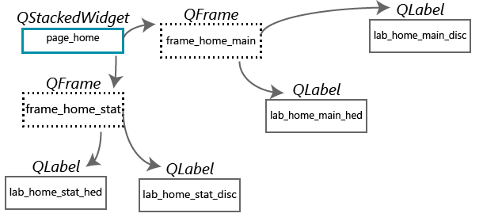

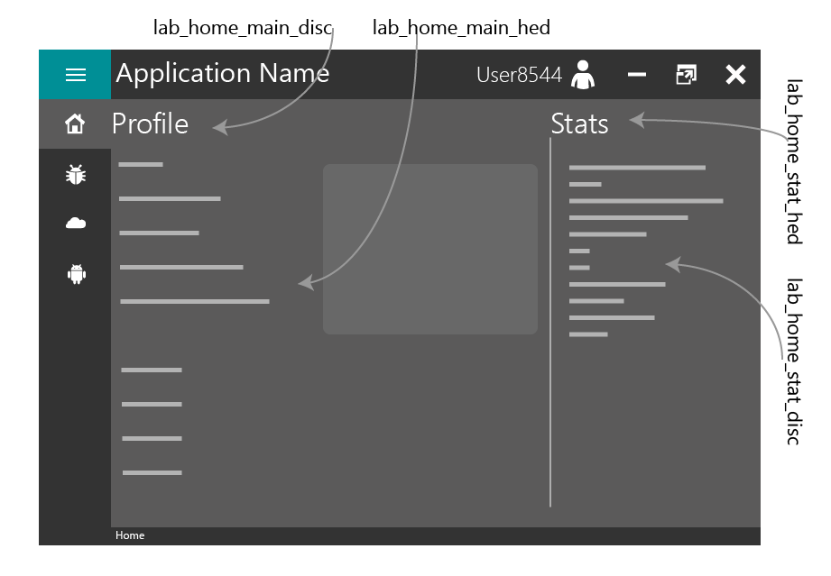

## Bug page

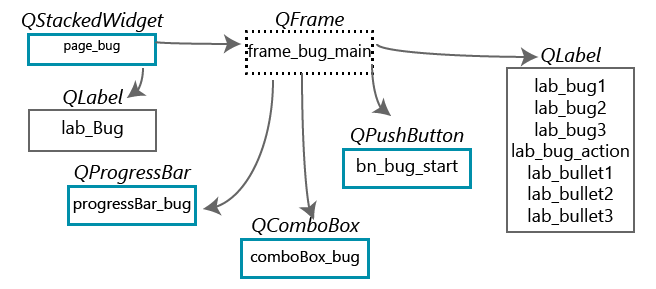

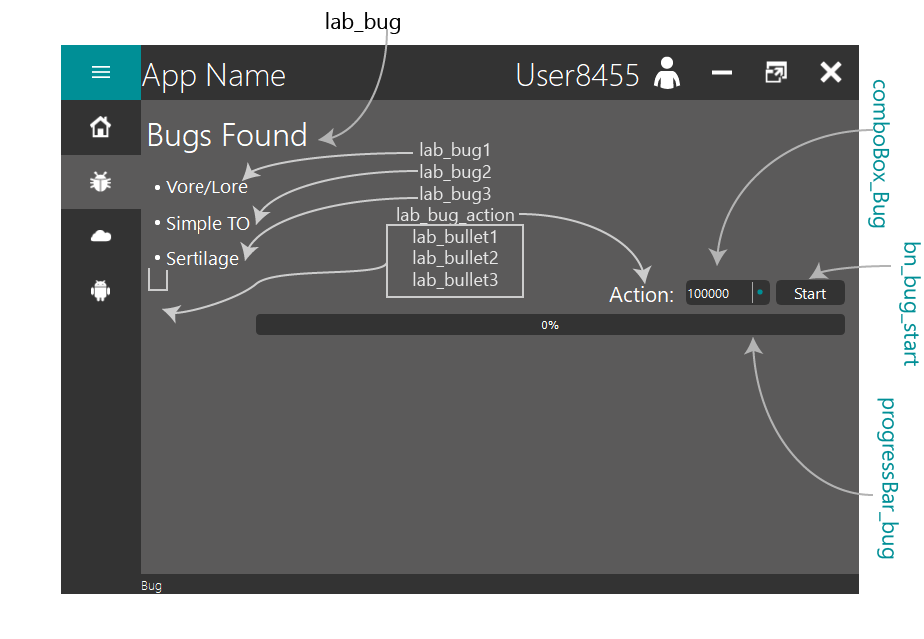

## Cloud page

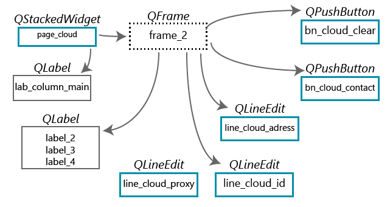

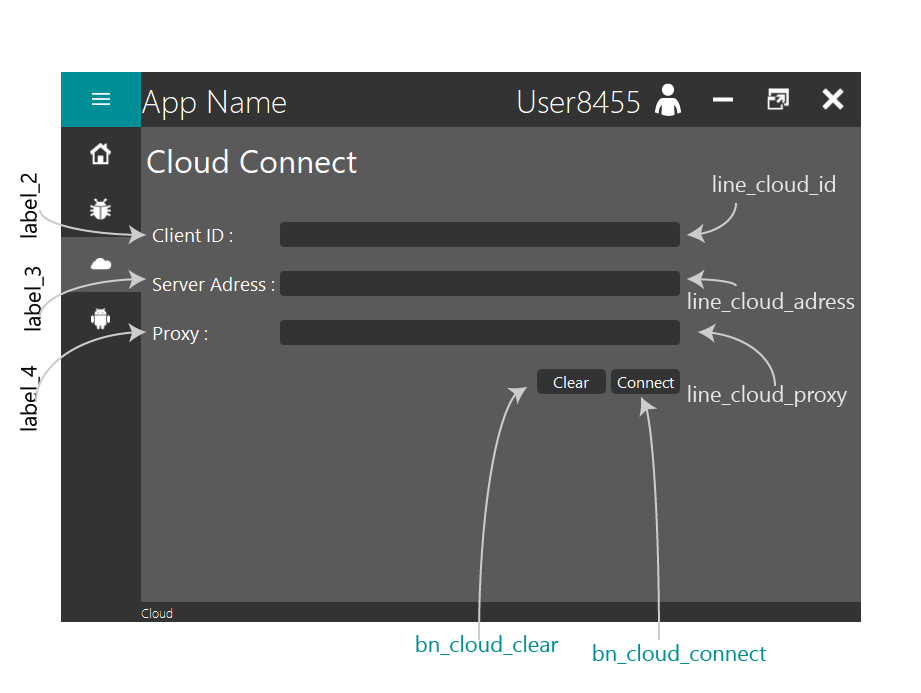

## Android page

`page_android` holds a second stacked widget, `stackedWidget_android`, with
four pages: `page_android_contact`, `page_android_game`, `page_android_clean`
and `page_android_world`.

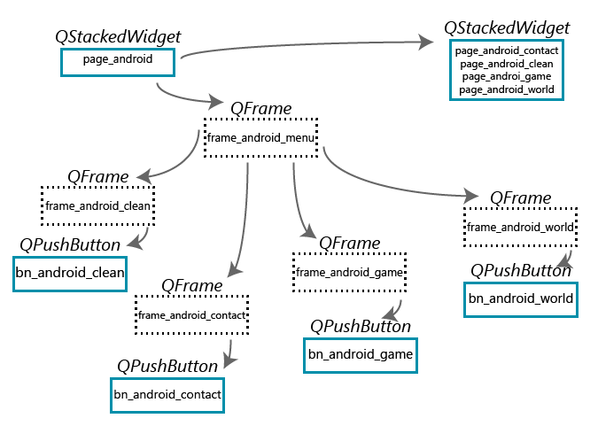

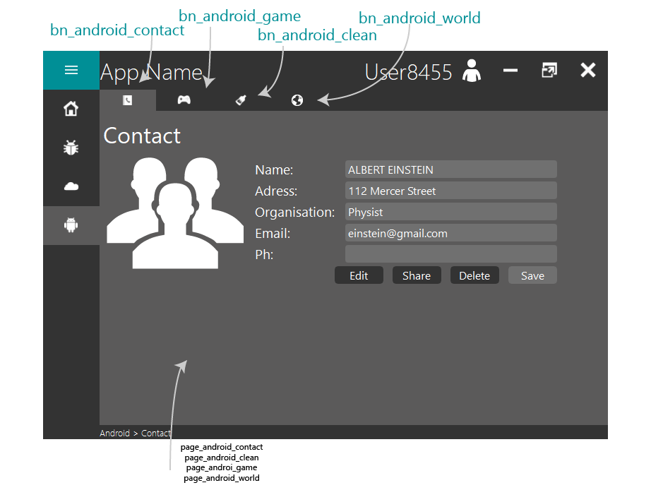

### Contact

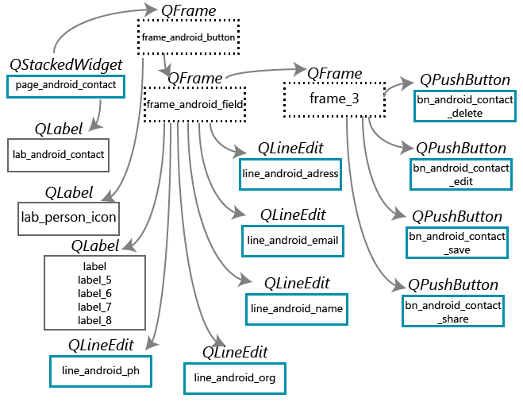

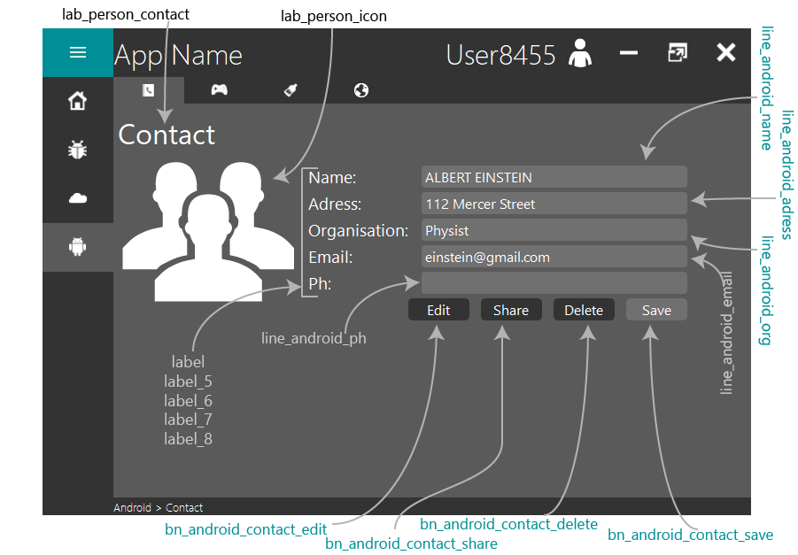

### GamePad, Clean and World

There are no diagrams for these three. Their widgets:

| Page                 | Widgets                                                                 |
| -------------------- | ----------------------------------------------------------------------- |
| `page_android_game`  | `lab_gamepad`, `frame_textbar`, `textEdit_gamepad`, `vsb_gamepad`        |
| `page_android_clean` | `lab_clean`, `groupBox_clean`, `groupBox`, `radioButton` to `radioButton_4`, `checkBox` to `checkBox_4`, `horizontalSlider_2`, `verticalSlider` |
| `page_android_world` | `label_9`                                                                |

[Widgets and stylesheets](widgets.md) has the calls and the stylesheet for
each of these widget types.

## Dialog box and error box

| Window              | Class in `main.py` | Widgets                                                                    |
| ------------------- | ------------------ | -------------------------------------------------------------------------- |
| `ui_dialog.ui`      | `dialogUi`         | `lab_heading`, `lab_message`, `lab_icon`, `bn_west`, `bn_east`, `bn_min`, `bn_close` |
| `ui_error.ui`       | `errorUi`          | `lab_heading`, `lab_icon`, `bn_ok`                                         |

Both have a `frame_top` that drags the box and a `frame_bottom` under it.
