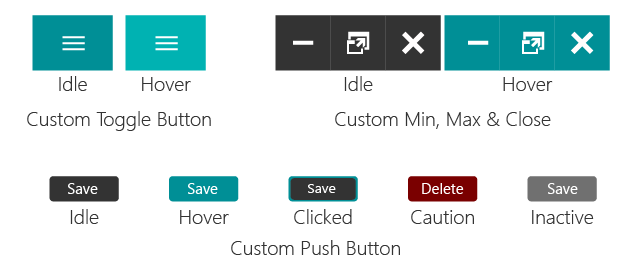
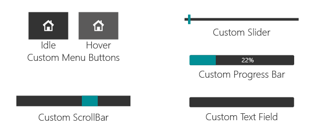
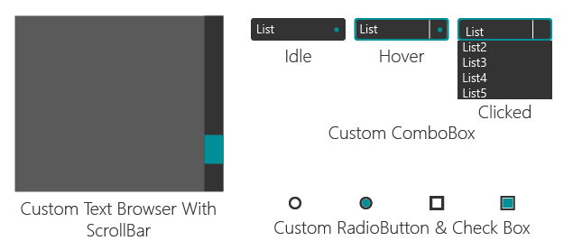

# Widgets and stylesheets

Every widget in the template is created, sized, given its icon and text, and
styled in Qt Designer. None of that appears in `main.py`. The Python side only
says what happens when the widget is used.

For each widget type this page gives the calls you are likely to need and the
stylesheet the template uses. The stylesheets are set on each widget in the
`.ui` files; `css.txt` is a reference copy that the application does not load.
In the snippets, `self.ui` is the `Ui_MainWindow` instance held by
`MainWindow`, and the names come from:

```python
from PySide6.QtCore import QSize, Qt
from PySide6.QtGui import QFont, QIcon
from PySide6.QtWidgets import (
    QCheckBox, QComboBox, QLineEdit, QProgressBar,
    QPushButton, QRadioButton, QScrollBar, QSlider,
)
```

The states each stylesheet produces:







## Push button

Push buttons are used in three places: the close, minimise and maximise
buttons; the menu buttons; and ordinary action buttons such as Save, Delete
and Connect.

```python
button = QPushButton(self.ui.frame_bug_main)  # create inside a frame
button.setObjectName("bn_name")
button.setMinimumSize(QSize(20, 20))
button.setMaximumSize(QSize(55, 55))
button.setEnabled(False)  # True to enable
button.setText("Start")
button.setStyleSheet("QPushButton { border: none; }")
button.setIcon(QIcon("icons/1x/homeAsset 46.png"))
button.setIconSize(QSize(22, 22))
button.setFlat(True)
button.setToolTip("Name")

font = QFont()
font.setFamily("Segoe UI")
font.setPointSize(12)
button.setFont(font)

button.clicked.connect(lambda: print("clicked"))
```

Close, minimise and maximise:

```css
QPushButton {
    border: none;
    background-color: rgba(0,0,0,0);
}
QPushButton:hover {
    background-color: rgb(0,143,150);
}
QPushButton:pressed {
    background-color: rgba(0,0,0,0);
}
```

Menu buttons:

```css
QPushButton {
    border: none;
    background-color: rgba(0,0,0,0);
}
QPushButton:hover {
    background-color: rgb(91,90,90);
}
QPushButton:pressed {
    background-color: rgba(0,0,0,0);
}
```

Start, Save, Close, Restore, Connect, Edit:

```css
QPushButton {
    border: 2px solid rgb(51,51,51);
    border-radius: 5px;
    color: rgb(255,255,255);
    background-color: rgb(51,51,51);
}
QPushButton:hover {
    border: 2px solid rgb(0,143,150);
    background-color: rgb(0,143,150);
}
QPushButton:pressed {
    border: 2px solid rgb(0,143,150);
    background-color: rgb(51,51,51);
}
QPushButton:disabled {
    border-radius: 5px;
    border: 2px solid rgb(112,112,112);
    background-color: rgb(112,112,112);
}
```

Delete, Remove:

```css
QPushButton {
    border: 2px solid rgb(51,51,51);
    border-radius: 5px;
    color: rgb(255,255,255);
    background-color: rgb(51,51,51);
}
QPushButton:hover {
    border: 2px solid rgb(112,0,0);
    background-color: rgb(112,0,0);
}
QPushButton:pressed {
    border: 2px solid rgb(112,0,0);
    background-color: rgb(51,51,51);
}
QPushButton:disabled {
    border-radius: 5px;
    border: 2px solid rgb(112,112,112);
    background-color: rgb(112,112,112);
}
```

Reference: [QPushButton](https://doc.qt.io/qtforpython-6/PySide6/QtWidgets/QPushButton.html).

## Progress bar

```python
bar = self.ui.progressBar_bug
bar.setRange(0, 100)  # or setMinimum() and setMaximum()
bar.setValue(22)  # call this from your own code as the work advances
bar.setAlignment(Qt.AlignmentFlag.AlignCenter)
bar.setTextVisible(True)  # show the percentage
bar.setOrientation(Qt.Orientation.Horizontal)
bar.setInvertedAppearance(False)
```

```css
QProgressBar {
    color: rgb(255,255,255);
    background-color: rgb(51,51,51);
    border: 2px;
    border-radius: 4px;
}
QProgressBar::chunk {
    border: 2px;
    border-radius: 4px;
    background-color: rgb(0,143,170);
}
```

Reference: [QProgressBar](https://doc.qt.io/qtforpython-6/PySide6/QtWidgets/QProgressBar.html).

## Combo box

```python
combo = self.ui.comboBox_bug
combo.addItem("10000")  # append an item
combo.setItemText(0, "100")  # replace the text of the item at an index
combo.currentIndex()  # index of the item shown
combo.currentText()  # its text
combo.setMaximumSize(QSize(16777215, 25))  # 16777215 is Qt's "no limit"
```

```css
QComboBox {
    border: 2px solid rgb(51,51,51);
    border-radius: 5px;
    color: rgb(255,255,255);
    background-color: rgb(51,51,51);
}
QComboBox:hover {
    border: 2px solid rgb(0,143,170);
    border-radius: 5px;
    color: rgb(255,255,255);
    background-color: rgb(0,143,170);
}
QComboBox:!editable, QComboBox::drop-down:editable {
    background: rgb(51,51,51);
}
QComboBox:!editable:on, QComboBox::drop-down:editable:on {
    background: rgb(51,51,51);
}
QComboBox:on { /* shift the text when the popup opens */
    padding-top: 3px;
    padding-left: 4px;
}
QComboBox::drop-down {
    subcontrol-origin: padding;
    subcontrol-position: top right;
    width: 15px;
    border-left-width: 1px;
    border-left-color: darkgray;
    border-left-style: solid; /* just a single line */
    border-top-right-radius: 5px; /* same radius as the QComboBox */
    border-bottom-right-radius: 5px;
}
QComboBox::down-arrow {
    image: url(icons/1x/arrow.png);
}
QComboBox::down-arrow:on { /* shift the arrow when popup is open */
    top: 1px;
    left: 1px;
}
QComboBox::drop-down {
    background: rgb(51,51,51);
}
```

The arrow image is a relative path, like the icons, so it resolves against the
working directory.

Reference: [QComboBox](https://doc.qt.io/qtforpython-6/PySide6/QtWidgets/QComboBox.html).

## Radio button

```python
radio = self.ui.radioButton
radio.setAutoExclusive(True)  # one of the group at a time
radio.isChecked()
radio.toggled.connect(lambda checked: print(checked))
```

```css
QRadioButton {
    background: rgb(91,90,90);
    color: white;
}
QRadioButton::indicator {
    width: 10px;
    height: 10px;
    border-radius: 7px;
}
QRadioButton::indicator:checked {
    background-color: rgb(0,143,170);
    border: 2px solid rgb(51,51,51);
}
QRadioButton::indicator:unchecked {
    background-color: rgb(91,90,90);
    border: 2px solid rgb(51,51,51);
}
```

Reference: [QRadioButton](https://doc.qt.io/qtforpython-6/PySide6/QtWidgets/QRadioButton.html).

## Check box

```python
box = self.ui.checkBox
box.setTristate(False)  # True adds a third, partially checked state
box.isChecked()
box.stateChanged.connect(lambda state: print(state))
```

```css
QCheckBox {
    color: rgb(255,255,255);
}
QCheckBox::indicator {
    width: 10px;
    height: 10px;
}
QCheckBox::indicator:unchecked {
    border: 2px solid rgb(51,51,51);
    background: rgb(91,90,90);
}
QCheckBox::indicator:unchecked:pressed {
    border: 2px solid rgb(51,51,51);
    background: rgb(0,143,170);
}
QCheckBox::indicator:checked {
    background-color: rgb(0,143,170);
    border: 2px solid rgb(51,51,51);
}
QCheckBox::indicator:checked:pressed {
    border: 2px solid rgb(51,51,51);
    background: rgb(91,90,90);
}
```

Reference: [QCheckBox](https://doc.qt.io/qtforpython-6/PySide6/QtWidgets/QCheckBox.html).

## Slider

```python
slider = self.ui.verticalSlider
slider.setTracking(True)  # emit valueChanged while dragging
slider.setOrientation(Qt.Orientation.Vertical)
slider.setInvertedAppearance(False)
slider.setInvertedControls(False)
slider.setValue(5)
slider.value()  # the value at the moment of the call
slider.valueChanged.connect(lambda value: print(value))
```

Vertical:

```css
QSlider::groove:vertical {
    background: rgb(51,51,51);
    width: 5px
}
QSlider::handle:vertical {
    height: 10px;
    background: rgb(0,143,170);
    margin: 0 -8px
}
QSlider::add-page:vertical {
    background: rgb(51,51,51);
}
QSlider::sub-page:vertical {
    background: rgb(51,51,51);
}
```

Horizontal:

```css
QSlider::groove:horizontal {
    height: 5px;
    background: rgb(51,51,51);
}
QSlider::handle:horizontal {
    background: rgb(0,143,170);
    width: 10px;
    margin: -8px 0
}
QSlider::add-page:horizontal {
    background: rgb(51,51,51);
}
QSlider::sub-page:horizontal {
    background: rgb(51,51,51);
}
```

Reference: [QSlider](https://doc.qt.io/qtforpython-6/PySide6/QtWidgets/QSlider.html).

## Scroll bar

A scroll bar placed in Qt Designer can replace the built-in one of a text edit
or any other scroll area:

```python
self.ui.textEdit_gamepad.setVerticalScrollBar(self.ui.vsb_gamepad)
```

`UIFunction.stackPage` already makes this call for `textEdit_gamepad` and
`text_about_home`. Make it once per scroll bar: the text edit takes ownership
of the bar and deletes the one it had before, so handing it the same bar a
second time crashes.

```css
QScrollBar:vertical {
    background: rgb(51,51,51);
    width: 20px;
    margin: 0px 0px 0px 0px;
}
QScrollBar::handle:vertical {
    background: rgb(0,143,170);
}
QScrollBar::add-page:vertical {
    background: rgb(51,51,51);
}
QScrollBar::sub-page:vertical {
    background: rgb(51,51,51);
}
```

Reference: [QScrollBar](https://doc.qt.io/qtforpython-6/PySide6/QtWidgets/QScrollBar.html).

## Line edit

```python
line = self.ui.line_cloud_id
line.setText("test")
line.text()  # what the user entered, as a str
line.setEnabled(True)
line.setEchoMode(QLineEdit.EchoMode.Password)  # mask the input
line.setMinimumSize(QSize(400, 25))
line.setMaximumSize(QSize(500, 25))
```

```css
QLineEdit {
    color: rgb(255,255,255);
    border: 2px solid rgb(51,51,51);
    border-radius: 4px;
    background: rgb(51,51,51);
}
QLineEdit:disabled {
    color: rgb(255,255,255);
    border: 2px solid rgb(112,112,112);
    border-radius: 4px;
    background: rgb(112,112,112);
}
```

Reference: [QLineEdit](https://doc.qt.io/qtforpython-6/PySide6/QtWidgets/QLineEdit.html).

## Label and group box

```css
QLabel {
    color: rgb(255,255,255);
}
QGroupBox {
    border: 1px solid rgb(51,51,51);
    border-radius: 4px;
    color: white;
    background: rgb(91,90,90);
}
```
